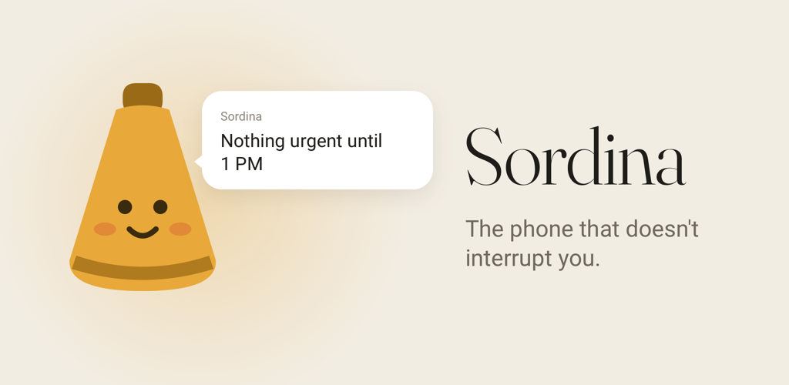
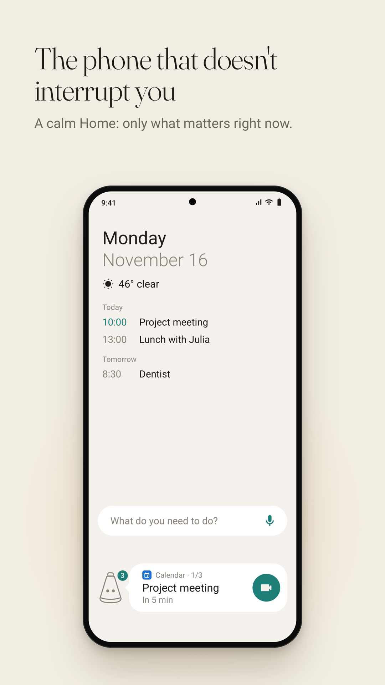
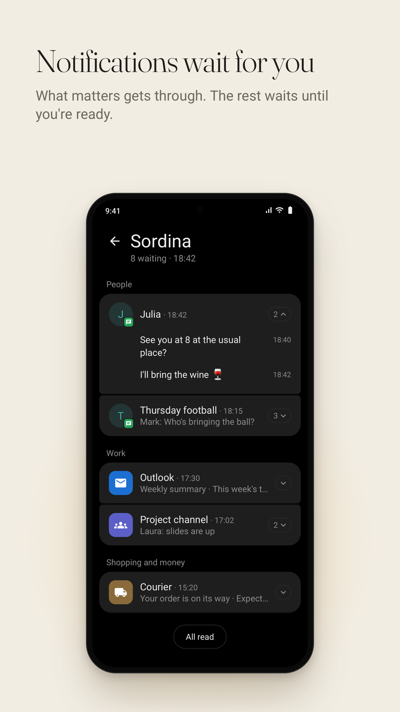
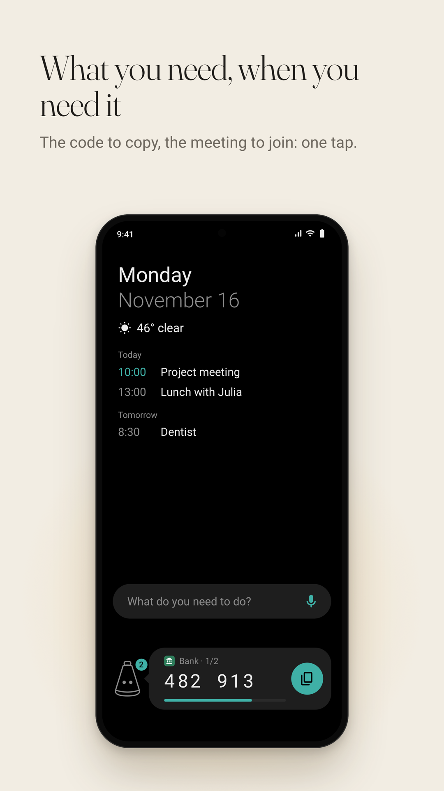
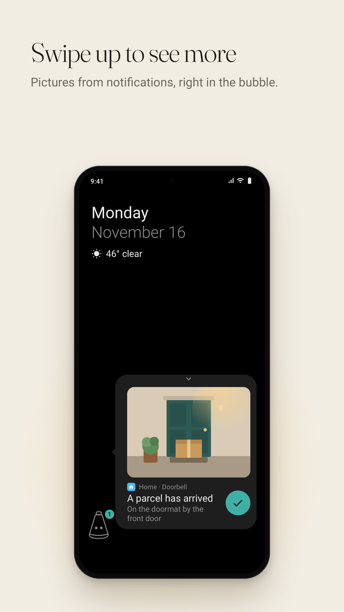
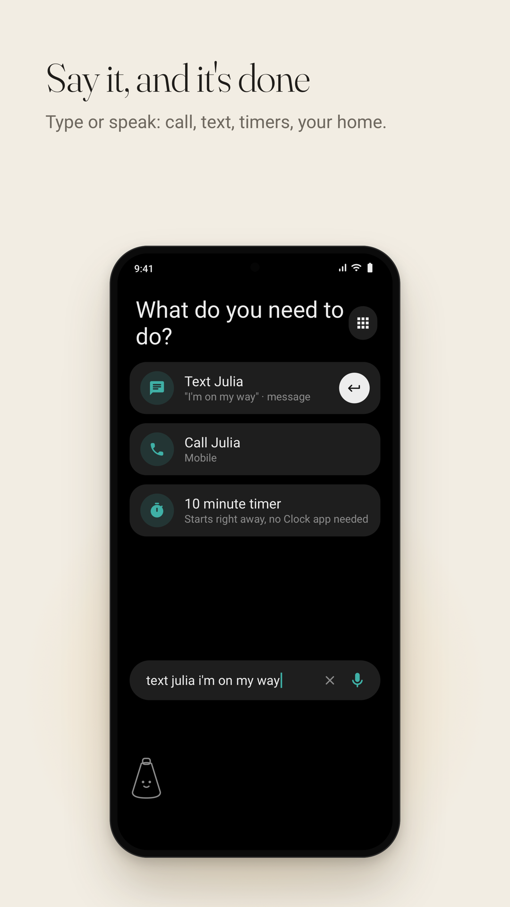
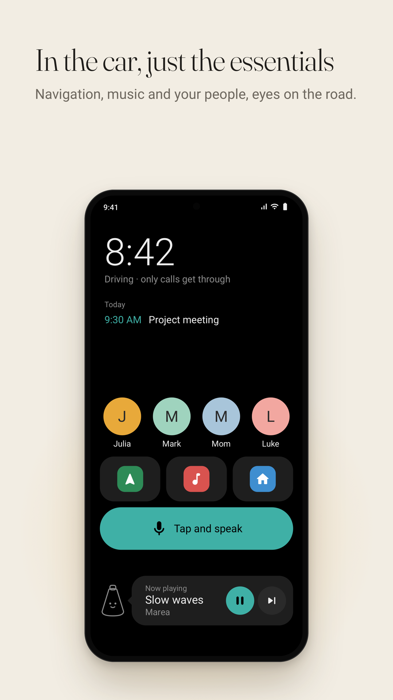
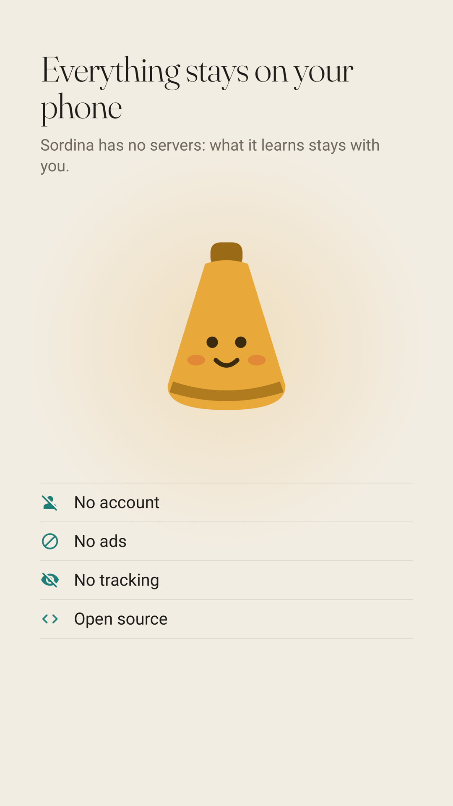

<p align="center">
  
</p>

<p align="center">
  <b>A calm Android launcher.</b> You pick up your phone because you need it, you do the thing, and it goes quiet again.<br>
  Nothing invites you to stay, nothing important slips by.
</p>

<p align="center">
  Android 8+ · 27 languages · no account · no ads · no tracking · no servers · GPL-3.0
</p>

> 🇮🇹 *Sordina* è un launcher per Android che mette il telefono in sordina: l'importante passa, il resto aspetta te. Tutto resta sul telefono. La scheda del Play Store in italiano è in [store/listing/it.md](store/listing/it.md).

---

## Why Sordina

Your phone is built to keep you on it: a grid of colourful icons, red badges, an endless shade of notifications. Every unlock is an invitation to stay.

Sordina flips that. It starts from **what you came to do**, lets **what matters** through, and keeps **everything else quiet** until you're ready. No willpower needed, no "screen time" guilt trip: just a phone that stops interrupting.

<table>
<tr>
<td width="50%" valign="top">

**Before**
- 40 icons asking for attention
- every group chat buzzes in real time
- you unlock to check the time, close it 20 minutes later
- verification codes buried in the shade

</td>
<td width="50%" valign="top">

**With Sordina**
- date, weather, your next plan, one bar
- the rest waits on one page, grouped by person
- you do the thing and the phone goes quiet
- the code is right there, one tap to copy

</td>
</tr>
</table>

---



### 🏠 A Home that's actually calm

Date, weather, your next plans and one bar to type or say what you need. That's it.

At the bottom lives a little brass mute (*sordina* is Italian for a trumpet mute). It tells you only what matters **right now**: the meeting in five minutes, the parcel at the door, the code you're waiting for.

Light, dark or automatic; solid, abstract or your own wallpaper, and text always stays readable.

<br clear="right">

---



### 🔕 Notifications wait for you

Important people, calls, verification codes and urgent messages **get through instantly**. Everything else is held on the Sordina page, grouped by person, until *you* decide to look.

- **nothing gets lost**: held notifications stay until you read them
- **you set the rules**, per person, per app, per notification type, and every held notification tells you why it's waiting
- **real urgency still gets through**: "urgent", "call me", or three messages in five minutes from one person
- **timed silence**: "mute for 45 minutes", "quiet until 3pm", then everything resumes
- **pictures included**: the photo from the doorbell or the chat, right there

<br clear="left">

---



### 💬 One thing at a time, ready to tap

The mascot's bubble hands you exactly what you need, when you need it:

- 🔐 the **verification code** to copy, with its countdown
- 📹 the **meeting about to start**, with *Join* for Teams, Meet, Zoom and Webex
- 📦 your ride, your parcel, a payment, the song you're playing
- 🏡 questions from your smart home, with the answers

Swipe sideways for the next thing. Long-press for options. No list, no feed, no rabbit hole.

<br clear="right">

---



### 🖼️ Swipe up to see more

When a notification carries a picture (the courier's photo, the doorbell camera, a snapshot in the family chat), drag the bubble up and it opens over the search bar. Drag it down and it's gone.

You see what you need without opening a single app.

<br clear="left">

---



### ✨ Say it, and it's done

Intent first, app second. Type or speak like you'd talk to a person:

> *"call Anna"* · *"text Mark I'm on my way"* · *"timer 10 minutes"*
> *"football tomorrow at 5pm"* · *"turn off the living room lights"*

Sordina does the right thing: places the call, writes the message in WhatsApp, Telegram, Signal or SMS, sets the timer without opening the Clock, puts the event in your calendar (with *Undo*). Voice is recognised **on the phone**, and Sordina learns from your corrections.

<br clear="right">

---



### 🚗 Home changes with you

- **Car**: a big clock, your navigation and music apps, the people you picked and a microphone you can hit without looking
- **Evening**: the day winds down, with a one-line recap and no charts
- **Night**: only the essentials, on a dark screen

Each mode switches on by itself and can be turned off whenever you like.

<br clear="left">

---

### 🖐️ A brake for "just because" apps

The apps you open out of habit ask for a moment before opening (and so do their websites in the browser). The apps you open with a purpose open straight away. It's not a lock, it's a speed bump.

### 🏡 Home Assistant, if you have it

Connect your home and ask it from the same bar: lights, shutters, scenes, questions. Your home can ask *you* things too, right in the bubble. Everything else works perfectly without it.

### 📱 Phones and tablets

Phones stay in portrait. On tablets Sordina rotates with the screen and keeps a comfortable column in the middle.

---



## 🔒 Everything stays on your phone

Sordina has no servers, no account and no analytics. Notifications, contacts, calendar, app usage and everything it learns are processed and stored on the phone. The only things that leave it:

| What | Where | When |
|---|---|---|
| Location rounded to ~10 km | [Open-Meteo](https://open-meteo.com) | Weather on, at most once an hour |
| Your commands | **Your own** Home Assistant | Only if you connect it |
| A daily copy of settings and what Sordina learned (no notifications, no token) | Your Google account, via Android backup | If backup is on |
| Device model, Android version, languages, error codes | Google, via ML Kit | Diagnostics of the on-device text and QR libraries |

Full policy (IT/EN): [store/privacy](store/privacy/index.html).

<br clear="right">

## 🔑 Permissions

All optional except notification access, which is the point of the app.

| Permission | Why |
|---|---|
| Notification access | Decide what gets through and what waits; codes, meetings and pictures in the bubble |
| Usage access | Ordering apps in search and the evening recap |
| Do Not Disturb access | Timed silence: turns Do Not Disturb on and off |
| Notifications | The quiet status card and alerts from Sordina itself |
| Contacts | "Call Anna", "text Anna"; important people; the people shown in the car |
| Calendar | Your next plans; "football tomorrow at 5pm" written straight in |
| Approximate location (while in use) | Weather only: no GPS, no Wi-Fi names |
| Microphone | Voice, with Android's on-device recogniser (Android 12+) |
| Phone | "Call Anna" places the call after your tap |
| Accessibility service | Instant brake (and the braked app's website, reading only the address bar), double-tap to lock, typing a phrase into Home Assistant Assist or Signal. Explained in the app, with explicit consent, before Android's settings open |
| Battery optimisation exemption | So Android doesn't put the notification sorting to sleep |
| Start at boot | Resume timed silence and held notifications after a restart |

## 🛠️ Build

Android SDK 36 and JDK 17–21 (Android Studio's bundled one works):

```bash
export JAVA_HOME="/Applications/Android Studio.app/Contents/jbr/Contents/Home"
./gradlew assembleDebug testDebugUnitTest
adb install -r app/build/outputs/apk/debug/app-debug.apk
```

The debug build installs as `app.sordina.debug`, next to the release one (`app.sordina`).

### Release

The upload key is never stored: `signing/release.sh` derives it from a password (PBKDF2-HMAC-SHA256, 2²¹ rounds, then a deterministic RSA-3072 key), checks its fingerprint against [signing/upload-cert.sha256](signing/upload-cert.sha256) and builds the signed bundle. Google Play App Signing holds the app key.

```bash
signing/release.sh   # → app/build/outputs/bundle/release/app-release.aab
```

## 🗂️ Repository

| Path | What's there |
|---|---|
| `app/src/main/java/app/sordina/data` | Intents, rules, cards, calendar, people, weather, Home Assistant, the on-device learning (`brain/`) |
| `app/src/main/java/app/sordina/service` | Notification listener, accessibility service, brake, scheduling |
| `app/src/main/java/app/sordina/ui` | Compose screens: Home, bubble, Sordina page, search, settings, onboarding |
| `app/src/main/res/values-*` | The 27 translations |
| `docs/` | Concept and UX notes (Italian) |
| `store/` | Play Store texts, graphics (rendered from `store/src/store.html`), privacy policy, Play Console notes |
| `signing/` | Password-derived upload key |

## 📄 License

[GPL-3.0](LICENSE).
